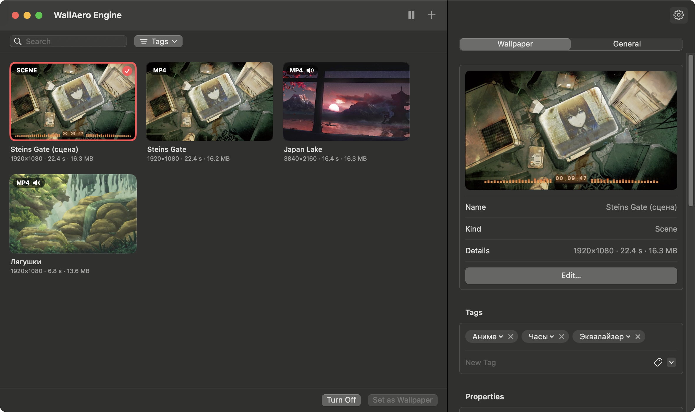
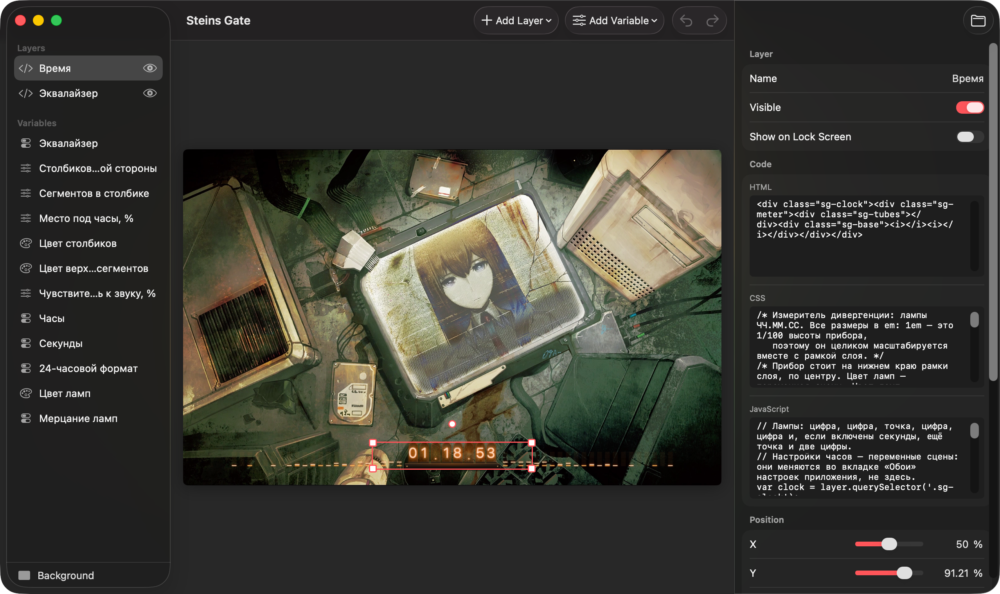
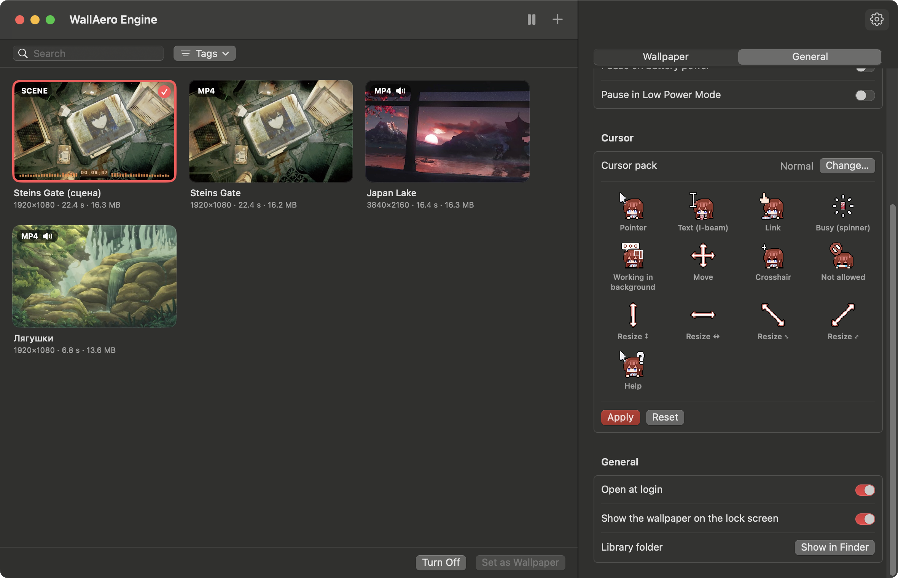

# WallAero Engine
**English** · [Русский](README.ru.md)

Live wallpapers for macOS: videos, GIFs and pictures on your desktop — beneath icons and windows, on every Space and every display. Plus animated cursors from Windows cursor packs.

## Installation

Build the app on your Mac. You need Xcode or its Command Line Tools (`xcode-select --install`) and macOS 13 Ventura or later. The first build downloads Chromium, which draws web pages among the wallpapers and the app's own scenes, and starts only when one of them is shown (about 130 MB for each processor), and builds the video encoders; later builds reuse them.

```bash
git clone https://github.com/M1nata1/WallAero-Engine.git
cd WallAero-Engine
scripts/build.sh --native && open "build/WallAero Engine.app"
```

An app built on your own Mac opens right away. To keep it in your Applications folder, run `scripts/build.sh --native --install`.

To run it straight from the sources, without building the app (Chromium comes from the first `scripts/build.sh --native`):

```bash
swift run --build-system native WallAeroEngine
```

### Ready-made build

A ready-made build is on the Releases page: [**download WallAeroEngine.zip**](https://github.com/M1nata1/WallAero-Engine/releases/latest/download/WallAeroEngine.zip). It runs on Macs with Apple silicon or Intel processors and needs macOS 13 Ventura or later.

1. Unzip the archive and drag WallAero Engine to your Applications folder.
2. Open the app. It is not notarized by Apple, so on first launch macOS stops it and says it cannot verify it. Close that message.
3. Open System Settings → Privacy & Security, click Open Anyway near the bottom and confirm with your password. You only have to do this once.

Instead of steps 2–3, you can remove the quarantine flag in Terminal; the app then opens without any warning:

```bash
xattr -dr com.apple.quarantine "/Applications/WallAero Engine.app"
```

## Features

<p align="center">
  
</p>

- **Formats:** MP4, MOV, M4V (H.264/HEVC), GIF, APNG, animated WebP and HEICS, plus still PNG, JPEG, HEIC and WebP.
- **GIFs and other animated images** are converted to H.264 once, on import. From then on they play through the hardware decoder like any other video, which is far more efficient than playing a GIF frame by frame. Small GIFs are scaled up by a whole number without smoothing, so pixel art stays crisp.
- **Multiple displays:** one wallpaper on every screen or a different one on each; you can also turn it off on a single display.
- **Energy saving:** playback pauses when windows cover the desktop — one window that fills the screen is enough — or a full-screen app does, while displays sleep and while the screen is locked. Optionally also on battery power and in Low Power Mode. Scenes and web wallpapers are held to 30 frames a second, or to the rate you choose. Video never keeps the display awake.
- **Scenes and an editor:** make scenes the way Wallpaper Engine makes them — pictures, texts, effects, particles, bones and animation — in an editor like its own, and export them for Wallpaper Engine. See [Scenes](#scenes).
- **Wallpaper Engine wallpapers:** add a wallpaper made for Wallpaper Engine as the archive it was downloaded in (`.zip`, `.rar` or `.7z`) — a web page, a scene or a video. A scene plays with its effects, particles, texts, scripts and sound, drawn by the app itself with Metal, without Chromium: two to three times less power. The genre, kind and age rating the wallpaper names become its tags. The wallpaper's own settings show in its settings here, and pages and scenes open in the editor like any scene, where a scene's own objects and effects can be changed too. See [Web wallpapers](#web-wallpapers).
- **Steam Workshop:** browse Wallpaper Engine's Workshop from the app and download wallpapers straight into the library. Browsing needs no account; downloading needs a Steam account that owns Wallpaper Engine. The first time you sign in, the app gets SteamCMD, Valve's download tool, from Valve; it does not come with the app. Your password goes to SteamCMD and is not saved.
- **Web wallpapers:** a folder with an `index.html` is shown as a wallpaper.
- **Reacting to sound:** an equalizer in a scene moves to whatever your Mac is playing: a song in any app, a video in the browser. See [Reacting to sound](#reacting-to-sound).
- **Your own music:** every wallpaper can have music of its own, played in place of its sound. Pick a folder in the wallpaper's settings: its subfolders and `.m3u` files become playlists. With no folder chosen, the sound comes from the video. See [Music](#music).
- **Cursors:** Windows cursor packs (`.ani`, `.cur`) replace the pointer across the whole system, animation included. Which file becomes which pointer is read from the pack's `install.inf`. See [Cursors](#cursors).
- **Controls:** a menu bar icon (pause, next wallpaper, quick pick), a library window with drag and drop, and Open With → WallAero Engine in Finder. In the library, ⌘-click or ⇧-click selects several wallpapers and ⌘A all of them; the Delete key deletes the selected ones together.
- **Search and tags:** find a wallpaper by its name, give wallpapers tags of your own, sort the tags into categories and tick the ones the library should show.
- **Settings of every wallpaper:** scaling (fill / fit / stretch), which part stays in view when filling crops the picture, speed and music. A scene adds the settings its author put up for changing.
- **Settings of the app:** sound and volume, open at login, and the wallpaper on the lock screen (the frame it showed when the screen locked; Mission Control shows a still of it).
- **Interface language:** English or Russian, following the system language; any other language gets English. To change it for WallAero Engine alone, go to System Settings → General → Language & Region → Applications.

## Building from source

You need Xcode 15 or later and macOS 13 Ventura or later; for the look of macOS 26, Xcode 26 or later. With only the Command Line Tools (Swift 5.9+), universal builds are not available — use `--native`.

The app is universal: macOS runs the version for its own processor, Apple silicon or Intel.

```bash
scripts/build.sh              # build "build/WallAero Engine.app" for Apple silicon and Intel
scripts/build.sh --install    # build and copy to /Applications
scripts/build.sh --dist       # build and pack into dist/WallAeroEngine.zip, for a release
scripts/build.sh --native     # this Mac's processor only: twice as fast, for development
swift test                    # import, conversion and cursor-reading tests
scripts/screenshots.sh        # retake the README screenshots in both languages in docs/screenshots
```

`swift run --build-system native WallAeroEngine` and an editor's Run button start the program without the app around it. That is enough to try a change, but its settings are kept apart from the app's, and macOS takes it for a different program when it asks for permissions.

## Usage

1. Launch WallAero Engine — the first time, it opens an empty library.
2. Drag files or folders into the window, or click + in the toolbar.
3. Double-click a wallpaper (or click Set as Wallpaper), and it is on your desktop.

Above the wallpapers there is a search field and the Tags button. The search looks in names and tags; ⌘F puts the cursor into it. Tags drops down the library's tags, each with a checkbox, under the names of their categories. Tick tags of one category and the wallpapers that have any of them stay; tick tags of several categories and a wallpaper needs one from each.

A wallpaper gets its tags in its settings, under Tags: type one and press Return, or pick one other wallpapers already have. Click a tag there to put it into a category or to make a new one; the category goes with the tag on every wallpaper. Tags are in a wallpaper's context menu as well.

The settings are at the side of the same window; the gear button hides and shows them, and ⌘, opens the app's own. They have two tabs. Wallpaper is about the wallpaper selected in the library: its preview, the button that opens it in the editor, its scaling, position and speed, and the [variables](#scenes) of a scene. General holds the app's own settings. Everything else is in the menu bar icon. While its windows are closed, the app takes no space in the Dock.

## Music

Music is set wallpaper by wallpaper. Select a wallpaper in the library, and in its settings, under Music, click Choose Folder… and pick a folder with your songs. Sound turns on by itself, and while that wallpaper is on, the music plays in place of its own sound. Another wallpaper can have other music, or none.

- **Playlists.** Every subfolder with music in it is a playlist, and so is every `.m3u` or `.m3u8` file. In the wallpaper's settings you choose one playlist or All Music. Songs lying directly in the chosen folder play only under All Music.
- **Order.** Songs play in order, around and around. Shuffle plays them in random order: each one once before any repeats.
- **Formats:** MP3, M4A, AAC, WAV, AIFF and FLAC. A file that cannot be opened is skipped.
- **Next Track** is in the menu bar icon's menu, which also shows the song that is playing.
- **Pausing.** Music keeps playing while windows cover the desktop. It pauses together with the wallpaper: on Pause in the menu, while the screen is locked or the displays sleep and, if you turned those on, on battery power and in Low Power Mode. Without a wallpaper chosen, music does not play. With the volume all the way down nothing plays either, and the music goes on from the same place when you turn it up.
- **Changing wallpapers.** The music changes with the wallpaper. If the new wallpaper has the same folder, the song goes on.
- **Several displays.** Only one wallpaper is heard: on the first display, in the order of the menu bar, whose wallpaper has music of its own or sound in its video.
- **Back to the video's sound:** click Remove next to the folder.
- **Sound and volume** are for all wallpapers at once: Settings → General → Playback.

## Scenes

<p align="center">
  
</p>

A scene is a wallpaper made the way Wallpaper Engine makes its scenes, and the editor works like Wallpaper Engine's own, in the manner of a Mac app. File → New Scene (⌘N) makes an empty one at the size of your display; Edit as Scene… in the settings of a video or a picture makes one with it as the background. A Wallpaper Engine scene you add opens in the editor as it is.

- **Objects:** pictures, videos, texts, solid colors, particles, sounds, composition layers and groups, listed front first, each with what hangs on it under it. Select one in the list or in the preview; drag it, pull its corners, turn it by the round handle. Its properties — position, scale, rotation, parallax depth, opacity, color, blend mode, and what belongs to its kind — are on the right.
- **Effects:** Add Effect… puts one of the app's sixteen effects on a picture or a text — tint, color adjustment, blur, shake, sway, water ripple and waves, shine, film grain and more. Each can be switched off, set, moved or removed.
- **Particles:** snow, rain, fireflies, dust, embers and bubbles to start from. Edit Particle System… changes where particles are made, what each starts with, what happens to it over time and how it is drawn.
- **Puppet warp:** a mesh over the picture, bones that bend it, and animations made of keys on a timeline. A bone can also sway by itself, on a spring or hanging.
- **Wallpaper settings:** checkboxes, sliders, colors, lists and texts that whoever uses the wallpaper changes, in Wallpaper Engine or here; an object's visibility, opacity, color or text can follow one.
- **Saving.** Changes are saved by themselves and show on the desktop at once if the scene is the current wallpaper. ⌘Z undoes, ⇧⌘Z redoes.
- **To Wallpaper Engine.** Export → Export for Wallpaper Engine… writes the project folder; put it into Wallpaper Engine's `projects/myprojects` folder and it opens there. Export as ZIP Archive… packs the same folder.

A scene made before this editor — with layers of text, pictures and shapes over a background — becomes one of these when it is opened. A scene with a layer of code, or with a web page as its background, keeps the earlier editor: layers of text, image, shape and code (HTML, CSS and JavaScript), placeholders such as `{HH}:{mm}` in a text, and variables a scene reads by name.

A scene keeps its Wallpaper Engine project in its `project` folder — Export → Show Project in Finder opens it — and the app lays it out for the page that plays it. A scene of the earlier kind is an ordinary web page; the folder button in its editor opens its files:

```
scene.json    the scene itself; the editor reads and writes only this
index.html    the page — generated by the app
runtime.js    turns scene.json into the page — generated by the app
custom.css    your own styles, loaded after the scene's
custom.js     your own script, run after the scene is built
media/        the background and the layers' pictures
```

The app rewrites `index.html` and `runtime.js` when it updates, so put your own code in `custom.css`, `custom.js` or a code layer. Edit the files in any editor: the wallpaper on the desktop updates when you save.

### Reacting to sound

A scene or a web wallpaper can move to the sound your Mac is playing: a song in any app, a video in the browser, the app's own music. The first time such a wallpaper is shown, macOS asks whether WallAero Engine may record system audio — click Allow. The app only measures how loud the low, middle and high notes are at each moment. Nothing is recorded or sent anywhere.

In a code layer or in `custom.js`, register a listener, the same way as in Wallpaper Engine:

```js
window.wallpaperRegisterAudioListener(levels => {
  const bass = Math.max(levels[4], levels[68]);   // the same band of the left and the right channel
  layer.style.transform = `scale(${1 + bass * 0.2})`;
});
```

About thirty times a second the listener gets 128 numbers from 0 to 1: 64 bands of the left channel, then 64 of the right, low notes first. The levels adjust to how loud the source is, so a quiet video moves the bars as much as a loud song does. In silence every number is 0.

- **If you clicked Don't Allow** and the bars lie flat, open System Settings → Privacy & Security → Screen & System Audio Recording and turn WallAero Engine on under System Audio Recording Only.
- The Mac's sound is listened to only while such a wallpaper is playing on screen: not while it is paused or covered by windows, and never for wallpapers that do not ask for it.
- This needs macOS 14.2 or later. On older systems the listener is never called.

### Web wallpapers

A wallpaper made for Wallpaper Engine is added the way it was downloaded: click + and choose its archive (`.zip`, `.rar` or `.7z`), or drag the archive into the window. Its unpacked folder, the one with `project.json` in it, is added the same way. An archive with several wallpapers in it adds them all. Where an archive holds a preset — settings made for another wallpaper — next to that wallpaper, the two are added as one: the wallpaper under the preset's name, with the preset's values and the pictures it chooses. The genre, the kind and the age rating a wallpaper names become its tags, each in a category of its own.

- **A web wallpaper** becomes a scene with the page as its background. The page's own settings — colors, sliders, switches, lists — show in the wallpaper's settings, named in the app's language when the wallpaper has a translation, and a change shows on the desktop at once. In the editor you can put layers of your own over the page: a clock, a text, a picture.
- **A video wallpaper** is added as a plain video.
- **A scene** — a wallpaper with `scene.pkg` in it — is played as it is: its pictures and the videos that stand in for pictures, with their effects, drawn by the scene's own shaders, pictures that bend on bones with their animations, its particles, also those that trail the pointer, its texts and sounds, the values it changes over time and its scripts, which follow the clock, the pointer and clicks. Layers hang on one another and are turned in depth as the scene has them. It moves with the pointer and glows where it is bright if it is made to. A text is written in the font the scene names if the Mac has it, and in a similar one if not. The settings its author gave it show in the wallpaper's settings. A wallpaper that shows what music is playing — its title, artist and cover — shows what plays in the app's own music, in Apple Music or in Spotify; for the cover from the last two, macOS asks once to let the app talk to them. It opens in the editor like a scene made in the app, and can be changed there and exported back for Wallpaper Engine. A scene added before this version keeps its earlier editor, which changes its objects over the scene as it came; add the wallpaper again to change it in the new one. 3D models are drawn lit by the scene's lights, its ambient and sky light; particles can bounce off a model and be made over the shape of a picture. Bones that sway by themselves — on a spring or hanging under gravity — sway as the author set them. A model whose shape cannot be read is left out, and the app says so when it adds the wallpaper. Where a scene uses a texture that only Wallpaper Engine has — the shapes of its stock particles, for one — one drawn by the app stands in for it; of the fonts Wallpaper Engine comes with, the app brings those under an open license (8-bit Operator, Blackout, Noto Sans, Roboto Mono, Segment7, Twemoji Mozilla).
- Audio visualizers follow the sound your Mac is playing, see [Reacting to sound](#reacting-to-sound).
- Chromium plays only open video formats, so the videos and sounds of a web wallpaper or a scene are turned into WebM (VP9 and Opus) once, when it is added; the originals stay in the wallpaper's hidden `.originals` folder. Wallpapers added by an earlier version of the app are converted in the background when it first starts.
- The mouse reaches web wallpapers and scenes: they follow the pointer while it is over the desktop and take clicks on it. A click goes to the desktop as well, as ever, and where a window covers the wallpaper the mouse is the window's.
- Scenes and web wallpapers use more energy and memory than plain video: they are drawn by Chromium, which comes with the app. In the settings, under General → Energy, you choose how many frames a second they draw — 30 unless you change it — and at what render scale: 1× is the display's own resolution, 0.75× a quarter less each way, down to 0.25×. Below 1×, what a page's scripts draw takes fewer pixels, while its text and pictures stay sharp. Plain videos keep taking the direct route. While paused, the page stands completely still.

Any other folder with an `index.html` in it, or an archive of one, is added the same way and shown as it is.

## Cursors

<p align="center">
  
</p>

WallAero Engine applies cursor packs made for Windows — like Mousecape, but with no manual conversion: the app turns `.ani` and `.cur` files into the macOS format by itself.

1. Unpack the cursor pack into a folder — it usually contains `.ani` / `.cur` files and an `install.inf`.
2. Open Settings → General → Cursor → Choose Folder…. The cursors show up in the preview, already animated.
3. Click Apply and move the mouse.

If the pack has an `install.inf`, the mapping comes from it. Both common layouts are supported: one line per cursor in `[Wreg]`, and a single scheme list (`Control Panel\Cursors\Schemes`). Without an `install.inf`, cursors are matched by file name (`Normal`, `Text`, `Busy`, `Link`, `Help` and so on). One Windows cursor can replace several macOS cursors at once:

| Cursor in the pack | Where it appears in macOS |
|---|---|
| `Arrow` | the regular arrow |
| `IBeam` | the text cursor |
| `Hand` | the hand over links; the make-alias arrow while dragging |
| `Wait` | busy |
| `AppStarting` | the arrow with a background-activity indicator |
| `Crosshair` | crosshairs in apps; the camera over a window when capturing a window (⌘⇧4, then Space) |
| `No` | "not allowed" while dragging |
| `SizeNS`, `SizeWE`, `SizeNWSE`, `SizeNESW` | resizing: window edges and corners, split-view dividers, the Dock divider |
| `SizeAll` | move, open hand and closed hand |
| `Help` | the arrow with a question mark |

`NWPen` (handwriting), `UpArrow` (alternate select), `Person` and `Pin` have no macOS equivalent, so such files are not applied.

Good to know:

- The pointer size is the system one: System Settings → Accessibility → Display → Pointer size.
- macOS shows at most 24 frames of a cursor animation. Longer animations are thinned out evenly, keeping the length of the loop.
- Cursors are replaced through an undocumented CoreGraphics API — the same one Mousecape uses. No system files are modified and SIP stays on. The original cursors are saved before they are replaced, so Reset brings back exactly them.
- The chosen pack is remembered: after a restart or a new login, WallAero Engine applies it again when it launches. If the pointer ever looks wrong, just restart the app or click Reset.
- If macOS puts its own cursors back by itself, for example after sleep or a display change, WallAero Engine notices within a few seconds and puts the pack's cursors back.
- macOS 26 draws the arrow and the text cursor from new system cursors (`ArrowS`, `IBeamS`). WallAero Engine themes them as well as the older ones.
- For window screenshots (⌘⇧4, then Space), the pack's crosshair is shown in place of the camera: Windows packs have no camera cursor.

The same from Terminal:

```bash
swift run cursorctl check "<folder>"   # show which file goes to which cursor, without changing anything
swift run cursorctl apply "<folder>"   # apply a pack
swift run cursorctl status             # show what is applied
swift run cursorctl verify "<folder>"  # list the pack's cursors macOS has replaced with its own
swift run cursorctl reset              # bring back the system cursors
```

## How it works

Each display gets a borderless window at desktop level (`kCGDesktopWindowLevel`): above the system wallpaper but below Finder icons and ordinary windows. The window lets clicks through, is present on every Space and is not hidden by ⌘H. Video plays through `AVQueuePlayer` + `AVPlayerLooper` — a seamless loop without reloading the file.

Scenes and web wallpapers are drawn by Chromium (the Chromium Embedded Framework) off screen, in processes of its own; each frame reaches the window through the graphics chip as an `IOSurface`, without a copy through the processor. A scene is stored as `scene.json`, and a small script, `runtime.js`, builds the page from it; the editor shows that same page and adds selecting and dragging on top. While paused, the page stops drawing and stands behind a snapshot of itself: its videos, animations and timers stop.

Cursors are registered with the WindowServer through undocumented CoreGraphics functions (`CGSRegisterCursorWithImages` and its neighbours). The frames of an `.ani` are taken from its embedded `.cur` images at the largest size and passed as a single vertical strip — the form in which the WindowServer accepts an animated cursor.

```
Sources/
  WallpaperCore/          import, GIF → H.264 and video → WebM conversion, thumbnails, library, music, scenes (no UI, covered by tests)
  CEFHost/                Chromium in the app: starting it, pages drawn off screen, the bridge to pages
  CEFWrapper/             CEF's headers and C++ wrapper, as CEF ships them
  WallAeroHelper/         the program Chromium starts its processes with
  CCodecs/                loading the VP9 and Opus encoders (libvpx, libopus)
  CursorCore/             reading .ani/.cur and install.inf, applying and resetting cursors (covered by tests)
  CGSCursor/              Swift declarations of the undocumented cursor API (C)
  cursorctl/              command-line tool for cursors
  WallAeroEngine/
    Engine/               desktop windows, players, web wallpapers, pause logic
    UI/                   menu bar, library window, settings, scene editor (SwiftUI)
    AppDelegate.swift     launch, main menu, opening files
    ScreenshotMode.swift  taking the README screenshots (--screenshots)
Tests/                    WallpaperCore and CursorCore tests
Resources/                Info.plist, icon, translations
scripts/                  building the .app, preparing Chromium and the encoders, drawing the icon, screenshots
docs/screenshots/         README screenshots: en/ and ru/
dist/                     the ready-made build for a release (scripts/build.sh --dist)
```

The library is kept in `~/Library/Application Support/WallAeroEngine`: imported files are copies, so you can move or delete the originals. The saved system cursors are kept there too, in `CursorBackup`.

Playback log:

```bash
log stream --predicate 'subsystem == "com.fadevec.WallAeroEngine"'
```

## Limitations

- macOS cannot play WebM, MKV or AVI out of the box — convert them to MP4 (H.264 or HEVC), for example with HandBrake.
- Live wallpapers do not play on the lock screen: macOS does not let third-party apps show anything there. If "Show the wallpaper on the lock screen" is on, the frame the wallpaper showed when the screen locked is shown instead.
