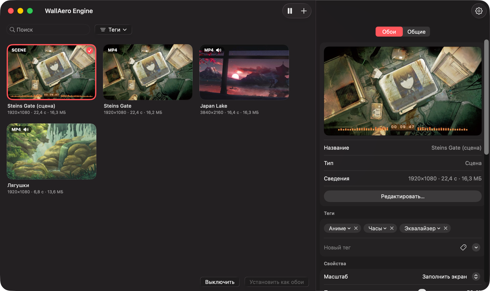
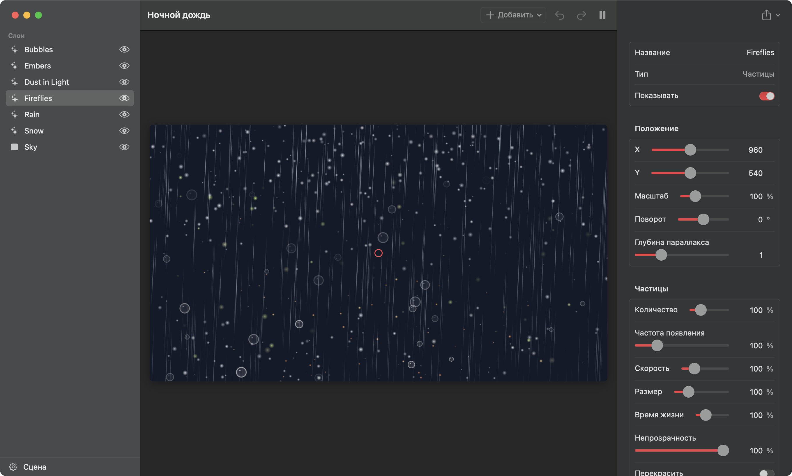
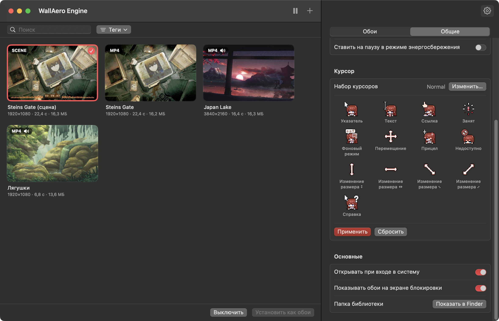

# WallAero Engine
[English](README.md) · **Русский**

Живые обои для macOS: видео, GIF и картинки на рабочем столе — под иконками и окнами, на всех рабочих столах (Spaces) и дисплеях. А ещё — анимированные курсоры из наборов для Windows.

## Установка

Соберите приложение на своём Mac. Нужен Xcode или его Command Line Tools (`xcode-select --install`) и macOS 13 Ventura или новее. Первая сборка скачивает Chromium, который рисует обои-веб-страницы и собственные сцены приложения и запускается, только когда такие обои на экране (около 130 МБ на каждый процессор), и собирает кодировщики видео; следующие сборки берут уже готовое.

```bash
git clone https://github.com/M1nata1/WallAero-Engine.git
cd WallAero-Engine
scripts/build.sh --native && open "build/WallAero Engine.app"
```

Приложение, собранное на своём Mac, открывается сразу. Чтобы оно осталось в папке «Программы», выполните `scripts/build.sh --native --install`.

Запустить прямо из исходников, не собирая приложение (Chromium берётся из первой `scripts/build.sh --native`):

```bash
swift run --build-system native WallAeroEngine
```

### Готовая сборка

Готовая сборка лежит на странице релизов: [**скачать WallAeroEngine.zip**](https://github.com/M1nata1/WallAero-Engine/releases/latest/download/WallAeroEngine.zip). Она подходит для Mac с Apple Silicon и Intel, нужна macOS 13 Ventura или новее.

1. Распакуйте архив и перетащите WallAero Engine в папку «Программы».
2. Откройте приложение. Оно не нотаризовано Apple, поэтому при первом запуске macOS его остановит и сообщит, что не может его проверить. Закройте это окно.
3. Откройте «Системные настройки» → «Конфиденциальность и безопасность», внизу нажмите «Все равно открыть» и подтвердите паролем. Это нужно сделать только один раз.

Вместо шагов 2–3 можно снять карантин в Терминале — тогда приложение сразу откроется без предупреждения:

```bash
xattr -dr com.apple.quarantine "/Applications/WallAero Engine.app"
```

## Возможности

<p align="center">
  
</p>

- **Форматы:** MP4, MOV, M4V (H.264/HEVC), GIF, APNG, анимированный WebP, HEICS, а также статичные PNG, JPEG, HEIC, WebP.
- **GIF и другие анимированные картинки** при импорте один раз перекодируются в H.264. Дальше они играют аппаратным декодером, как обычное видео, — это намного экономнее покадрового воспроизведения GIF. Маленькие GIF увеличиваются в целое число раз без сглаживания, поэтому пиксель-арт остаётся чётким.
- **Несколько дисплеев:** одни обои на все экраны или свои на каждый, можно выключить на отдельном дисплее.
- **Экономия энергии:** воспроизведение останавливается, когда рабочий стол закрыт окнами — достаточно одного окна во весь экран — или полноэкранным приложением, во время сна дисплеев и блокировки экрана. По желанию — от аккумулятора и в режиме энергосбережения. Сцены и веб-обои рисуются с частотой 30 кадров в секунду или с той, которую вы выберете. Видео не мешает дисплею засыпать.
- **Сцены и редактор:** сцены делаются так же, как в Wallpaper Engine, — картинки, надписи, эффекты, частицы, кости и анимация — в похожем на его собственный редакторе и экспортируются для Wallpaper Engine. Подробнее — в разделе [«Сцены»](#сцены).
- **Обои Wallpaper Engine:** обои, сделанные для Wallpaper Engine, добавляются тем же архивом, в котором они скачаны (`.zip`, `.rar` или `.7z`), — веб-страница, сцена или видео. Сцена играет со своими эффектами, частицами, надписями, скриптами и звуком, и рисует её само приложение через Metal, без Chromium: энергии уходит в два-три раза меньше. Жанр, тип и возрастной рейтинг, указанные в обоях, становятся их тегами. Собственные настройки обоев видны в их настройках здесь, а страницы и сцены открываются в редакторе, как любая сцена; у сцены там можно менять и её собственные объекты и эффекты. Подробнее — в разделе [«Веб-обои»](#веб-обои).
- **Веб-обои:** папка с `index.html` показывается как обои.
- **Реакция на звук:** эквалайзер в сцене двигается под то, что играет на Mac: песню в любом приложении, видео в браузере. Подробнее — в разделе [«Реакция на звук»](#реакция-на-звук).
- **Своя музыка:** у каждых обоев может быть своя музыка, она играет вместо их звука. Укажите папку в настройках обоев: вложенные папки и файлы `.m3u` станут плейлистами. Если папка не выбрана, звук берётся из видео. Подробнее — в разделе [«Музыка»](#музыка).
- **Курсоры:** наборы курсоров для Windows (`.ani`, `.cur`) заменяют указатель во всей системе, вместе с анимацией. Какой файл какому состоянию соответствует, берётся из `install.inf` набора. Подробнее — в разделе [«Курсоры»](#курсоры).
- **Управление:** иконка в строке меню (пауза, следующие обои, быстрый выбор), окно библиотеки с drag-and-drop, «Открыть в программе → WallAero Engine» из Finder. В библиотеке щелчок с ⌘ или ⇧ выделяет несколько обоев, ⌘A — все; клавиша Delete удаляет выделенные разом.
- **Поиск и теги:** находите обои по названию, давайте им свои теги, раскладывайте теги по категориям и отмечайте, какие обои показывать.
- **Настройки у каждых обоев:** масштаб (заполнить / вписать / растянуть), какая часть кадра остаётся видна, когда при заполнении он обрезается, скорость и музыка. У сцены к ним добавляются настройки, которые вынес её автор.
- **Настройки приложения:** звук и громкость, запуск при входе в систему, обои на экране блокировки (кадр, который был на экране в момент блокировки; в Mission Control виден неподвижный кадр обоев).
- **Язык интерфейса** — русский или английский, выбирается по языку системы. Для остальных языков включается английский. Только для WallAero Engine язык можно сменить в «Системные настройки» → «Основные» → «Язык и регион» → «Приложения».

## Сборка из исходников

Нужен Xcode 15 или новее и macOS 13 Ventura или новее; для оформления macOS 26 — Xcode 26 или новее. С одними Command Line Tools (Swift 5.9+) универсальная сборка недоступна — используйте `--native`.

Готовое приложение универсальное: macOS сама запускает версию для своего процессора — Apple Silicon или Intel.

```bash
scripts/build.sh              # собрать "build/WallAero Engine.app" для Apple Silicon и Intel
scripts/build.sh --install    # собрать и скопировать в /Applications
scripts/build.sh --dist       # собрать и упаковать в dist/WallAeroEngine.zip — архив для релиза
scripts/build.sh --native     # только для процессора этого Mac: вдвое быстрее, для разработки
swift test                    # тесты импорта, конвертации и чтения курсоров
scripts/screenshots.sh        # переснять скриншоты для README на обоих языках в docs/screenshots
```

`swift run --build-system native WallAeroEngine` и кнопка запуска в редакторе стартуют программу без приложения вокруг неё. Чтобы проверить правку, этого хватает, но настройки у такого запуска свои, отдельные от настроек приложения, а при запросе разрешений macOS считает его другой программой.

## Как пользоваться

1. Запустите WallAero Engine — при первом запуске откроется пустая библиотека.
2. Перетащите в окно файлы или папки либо нажмите «+» на панели инструментов.
3. Двойной щелчок по обоям (или «Установить как обои») — и они на рабочем столе.

Над обоями находятся поле поиска и кнопка «Теги». Поиск идёт по названиям и тегам; ⌘F ставит курсор в поле. Кнопка «Теги» открывает список тегов библиотеки с флажками, под названиями их категорий. Отметьте теги одной категории — останутся обои, у которых есть любой из них; отметьте теги из нескольких категорий — обоям нужен хотя бы один из каждой.

Теги обоям задаются в их настройках, в разделе «Теги»: введите тег и нажмите Return или выберите один из тех, что уже есть у других обоев. Нажмите на тег там же, чтобы отнести его к категории или создать новую; категория закрепляется за тегом на всех обоях. Теги есть и в контекстном меню обоев.

Настройки находятся сбоку в том же окне; кнопка с шестерёнкой скрывает и показывает их, а ⌘, открывает настройки приложения. В них две вкладки. «Обои» — про обои, выбранные в библиотеке: превью, кнопка, которая открывает их в редакторе, масштаб, положение кадра, скорость и [переменные](#сцены) сцены. «Общие» — настройки самого приложения. Остальное доступно из иконки в строке меню. При закрытом окне приложение не занимает место в Dock.

## Музыка

Музыка задаётся для каждых обоев отдельно. Выберите обои в библиотеке и в их настройках, в разделе «Музыка», нажмите «Выбрать папку…» и укажите папку со своими песнями. Звук включится сам, и пока эти обои на экране, музыка играет вместо их собственного звука. У других обоев может быть другая музыка или никакой.

- **Плейлисты.** Каждая вложенная папка с музыкой — плейлист, файл `.m3u` или `.m3u8` — тоже. В настройках обоев можно выбрать один плейлист или «Вся музыка». Песни, которые лежат прямо в выбранной папке, играют только в режиме «Вся музыка».
- **Порядок.** Песни идут по порядку и по кругу. «Перемешивать» ставит их в случайном порядке: каждая играет один раз, прежде чем какая-то повторится.
- **Форматы:** MP3, M4A, AAC, WAV, AIFF и FLAC. Файл, который не открывается, пропускается.
- **Следующий трек** — в меню значка в строке меню. Там же видно название песни, которая играет сейчас.
- **Пауза.** Музыка не останавливается, когда окна закрывают рабочий стол. На паузу она встаёт вместе с обоями: по «Пауза» в меню, при блокировке экрана и сне дисплеев, а если включено — при работе от аккумулятора и в режиме энергосбережения. Без выбранных обоев музыка не играет. При нулевой громкости тоже ничего не играет, а когда громкость прибавят, музыка продолжится с того же места.
- **Смена обоев.** Музыка меняется вместе с обоями. Если у новых обоев та же папка, песня продолжается.
- **Несколько дисплеев.** Слышны только одни обои: на первом по порядку строки меню дисплее, у обоев которого есть своя музыка или звук в видео.
- **Вернуть звук видео:** нажмите «Убрать» рядом с папкой.
- **Звук и громкость** общие для всех обоев: «Настройки» → «Общие» → «Воспроизведение».

## Сцены

<p align="center">
  
</p>

Сцена — это обои, устроенные так же, как сцены Wallpaper Engine, а редактор работает как редактор Wallpaper Engine, только в духе приложений для Mac. «Файл» → «Новая сцена» (⌘N) создаёт пустую сцену размером с экран; «Редактировать как сцену…» в настройках видео или картинки создаёт сцену с ними в качестве фона. Добавленная сцена Wallpaper Engine открывается в редакторе как есть.

- **Объекты:** картинки, видео, надписи, заливки, частицы, звуки, составные слои и группы. В списке они идут спереди назад, вложенные — под тем, во что вложены. Объект выбирается в списке или прямо в предпросмотре; его можно тянуть, растягивать за углы и поворачивать за круглую ручку. Справа — его свойства: положение, масштаб, поворот, глубина параллакса, непрозрачность, цвет, режим наложения и то, что есть у объектов этого типа.
- **Эффекты:** «Добавить эффект…» накладывает на картинку или надпись один из шестнадцати эффектов приложения — оттенок, цветокоррекцию, размытие, тряску, покачивание, рябь и волны, блик, плёночное зерно и другие. Каждый можно выключить, настроить, переставить или убрать.
- **Частицы:** снег, дождь, светлячки, пыль, искры и пузыри как заготовки. «Настроить систему частиц…» меняет, где появляются частицы, какими они рождаются, что с ними происходит со временем и как они рисуются.
- **Кости и анимация:** сетка поверх картинки, кости, которые её гнут, и анимации из ключей на шкале времени. Кость может и качаться сама — на пружине или под тяжестью.
- **Настройки обоев:** флажки, ползунки, цвета, списки и тексты, которые меняет тот, кто ставит обои, — в Wallpaper Engine или здесь. Видимость, непрозрачность, цвет или текст объекта можно связать с настройкой.
- **Сохранение.** Правки сохраняются сами и сразу видны на рабочем столе, если сцена выбрана обоями. ⌘Z отменяет действие, ⇧⌘Z возвращает.
- **В Wallpaper Engine.** «Экспорт» → «Экспортировать для Wallpaper Engine…» записывает папку проекта; положите её в папку Wallpaper Engine `projects/myprojects`, и сцена откроется там. «Экспортировать в ZIP-архив…» упаковывает ту же папку.

Сцена, сделанная до этого редактора, — со слоями текста, картинок и фигур поверх фона — при открытии переводится в новый вид. Сцена со слоем кода или с веб-страницей в качестве фона остаётся в прежнем редакторе: слои текста, изображения, фигуры и кода (HTML, CSS и JavaScript), подстановки вроде `{HH}:{mm}` в тексте и переменные, которые сцена читает по имени.

Проект Wallpaper Engine сцена хранит в своей папке `project` — её открывает «Экспорт» → «Показать проект в Finder», — а для страницы, которая её играет, приложение раскладывает его отдельно. Сцена прежнего вида — обычная веб-страница; кнопка с папкой в её редакторе открывает её файлы:

```
scene.json    сама сцена; редактор читает и пишет только её
index.html    страница — создаётся приложением
runtime.js    превращает scene.json в страницу — создаётся приложением
custom.css    ваши стили: подключаются после стилей сцены
custom.js     ваш скрипт: запускается после построения сцены
media/        фон и картинки слоёв
```

`index.html` и `runtime.js` приложение перезаписывает, когда обновляется, поэтому свой код пишите в `custom.css`, `custom.js` или в слое «Код». Файлы можно править в любом редакторе: обои на рабочем столе обновляются при сохранении.

### Реакция на звук

Сцена или веб-обои могут двигаться под звук, который играет на Mac: песню в любом приложении, видео в браузере, музыку самого WallAero Engine. Когда такие обои показываются впервые, macOS спрашивает, можно ли WallAero Engine записывать системный звук, — нажмите «Разрешить». Приложение только измеряет, насколько громко в каждый момент звучат низкие, средние и высокие ноты. Звук не записывается и никуда не отправляется.

В слое «Код» или в `custom.js` зарегистрируйте обработчик — так же, как в Wallpaper Engine:

```js
window.wallpaperRegisterAudioListener(levels => {
  const bass = Math.max(levels[4], levels[68]);   // одна и та же полоса левого и правого канала
  layer.style.transform = `scale(${1 + bass * 0.2})`;
});
```

Примерно тридцать раз в секунду обработчик получает 128 чисел от 0 до 1: 64 полосы левого канала, затем 64 правого, от низких нот к высоким. Уровни подстраиваются под громкость источника: тихое видео двигает столбики так же, как громкая песня. В тишине все числа равны 0.

- **Если вы нажали «Не разрешать»** и столбики лежат внизу, откройте «Системные настройки» → «Конфиденциальность и безопасность» → «Запись экрана и системного звука» и включите WallAero Engine в списке «Только запись системного звука».
- Звук Mac прослушивается, только пока такие обои играют на экране: на паузе и под окнами — нет, а для обоев, которым звук не нужен, — никогда.
- Нужна macOS 14.2 или новее. В более старых системах обработчик не вызывается.

### Веб-обои

Обои, сделанные для Wallpaper Engine, добавляются в том виде, в каком скачаны: нажмите «+» и выберите архив (`.zip`, `.rar` или `.7z`) или перетащите его в окно. Так же добавляется и распакованная папка — та, в которой лежит `project.json`. Если в архиве несколько обоев, добавятся все. Если в архиве рядом с обоями лежит пресет — набор настроек для них, — они добавятся как одни обои: под именем пресета, с его значениями и выбранными в нём картинками. Жанр, тип и возрастной рейтинг, указанные в обоях, становятся тегами — каждый в своей категории.

- **Веб-обои** становятся сценой, у которой страница служит фоном. Настройки самой страницы — цвета, ползунки, переключатели, списки — появляются в настройках обоев; если у обоев есть перевод, они названы на языке приложения. Изменение сразу видно на рабочем столе. В редакторе поверх страницы можно положить свои слои: часы, текст, картинку.
- **Видеообои** добавляются как обычное видео.
- **Сцена** — обои, в которых лежит `scene.pkg`, — воспроизводится как есть: картинки и видео, которые стоят на их месте, с эффектами, которые рисуют шейдеры самой сцены, картинки на костях с их анимацией, частицы, в том числе те, что тянутся за указателем, надписи и звуки, анимация свойств по времени и скрипты, которые следят за часами, указателем и нажатиями. Слои вложены друг в друга и повёрнуты в глубину так, как это сделано в сцене. Если автор так задумал, сцена сдвигается вслед за указателем и светится в ярких местах. Надпись пишется шрифтом, который назван в сцене, если он есть на Mac, а если нет — похожим. Настройки, которые дал сцене автор, видны в настройках обоев. Обои, которые показывают, что сейчас играет, — название, исполнителя и обложку, — показывают музыку самого приложения, «Музыки» или Spotify; ради обложки из последних двух macOS один раз спросит разрешение. Она открывается в редакторе так же, как сцена, сделанная в приложении: её можно менять и экспортировать обратно для Wallpaper Engine. Сцена, добавленная до этой версии, открывается в прежнем редакторе, который меняет её объекты поверх исходной сцены; чтобы править её в новом, добавьте обои заново. 3D-модели рисуются с освещением сцены: её источниками света, общим светом и светом неба. Частицы могут отскакивать от модели и вылетать из картинки по её форме. Кости, которые качаются сами — на пружине или под тяжестью, — качаются так, как их настроил автор. Модель, форму которой не удалось прочитать, пропускается, и приложение сообщает об этом при добавлении. Если сцена использует текстуру, которая есть только в самом Wallpaper Engine, — например, формы его стандартных частиц, — её заменяет нарисованная приложением. Из шрифтов, которые идут с Wallpaper Engine, приложение приносит те, что под открытой лицензией (8-bit Operator, Blackout, Noto Sans, Roboto Mono, Segment7, Twemoji Mozilla).
- Визуализаторы звука следуют за тем, что играет на Mac, см. [«Реакция на звук»](#реакция-на-звук).
- Chromium играет только открытые форматы видео, поэтому видео и звуки веб-обоев и сцен один раз перекодируются в WebM (VP9 и Opus) при добавлении; оригиналы остаются в скрытой папке обоев `.originals`. Обои, добавленные прежней версией приложения, перекодируются в фоне при первом запуске.
- Веб-обои и сцены реагируют на мышь: следят за указателем, пока он над рабочим столом, и принимают щелчки по нему. Щелчок при этом, как и всегда, достаётся и рабочему столу, а там, где обои закрыты окном, мышь принадлежит окну.
- Сцены и веб-обои расходуют больше энергии и памяти, чем обычное видео: их рисует Chromium, который входит в приложение. В настройках, в разделе «Общие» → «Энергосбережение», выбирается, сколько кадров в секунду они рисуют — 30, пока вы не измените, — и с каким масштабом рендеринга: 1× — родное разрешение экрана, 0,75× — на четверть меньше по каждой стороне, и так до 0,25×. При масштабе меньше 1× то, что рисуют скрипты страницы, занимает меньше пикселей, а текст и картинки остаются чёткими. Обычные видео идут прежним прямым путём. На паузе страница полностью замирает.

Любая другая папка с `index.html` или архив с ней добавляется так же и показывается как есть.

## Курсоры

<p align="center">
  
</p>

WallAero Engine ставит наборы курсоров, сделанные для Windows, — как Mousecape, только без ручной конвертации: `.ani` и `.cur` приложение переводит в формат macOS само.

1. Распакуйте набор в папку — обычно в ней лежат файлы `.ani` / `.cur` и `install.inf`.
2. Откройте «Настройки» → «Общие» → «Курсор» → «Выбрать папку…». Курсоры появятся в превью сразу с анимацией.
3. Нажмите «Применить» и подвигайте мышью.

Если в наборе есть `install.inf`, соответствие берётся из него. Поддерживаются оба распространённых вида: построчные записи в `[Wreg]` и общий список схемы (`Control Panel\Cursors\Schemes`). Без `install.inf` курсоры подбираются по именам файлов (`Normal`, `Text`, `Busy`, `Link`, `Help` и т. п.). Один курсор Windows может заменить сразу несколько курсоров macOS:

| Курсор в наборе | Где появится в macOS |
|---|---|
| `Arrow` | обычная стрелка |
| `IBeam` | текстовый курсор |
| `Hand` | рука над ссылками, стрелка создания псевдонима при перетаскивании |
| `Wait` | ожидание |
| `AppStarting` | стрелка с индикатором фоновой работы |
| `Crosshair` | прицел в приложениях; камера над окном при снимке окна (⌘⇧4, затем пробел) |
| `No` | «нельзя» при перетаскивании |
| `SizeNS`, `SizeWE`, `SizeNWSE`, `SizeNESW` | изменение размера: края и углы окон, разделители, граница Dock |
| `SizeAll` | перемещение, раскрытая и сжатая рука |
| `Help` | стрелка со знаком вопроса |

Для `NWPen` (рукописный ввод), `UpArrow` (альтернативный выбор), `Person` и `Pin` аналогов в macOS нет, поэтому такие файлы не применяются.

Что стоит знать:

- Размер указателя задаётся штатно: «Системные настройки» → «Универсальный доступ» → «Дисплей» → «Размер указателя».
- macOS показывает не больше 24 кадров анимации курсора. Более длинные анимации равномерно прореживаются, длительность цикла сохраняется.
- Курсоры заменяются через недокументированный API CoreGraphics — тот же, которым пользуется Mousecape. Системные файлы не меняются, отключать SIP не нужно. Перед заменой оригиналы сохраняются, поэтому «Сбросить» возвращает именно их.
- Выбранный набор запоминается: после перезагрузки или нового входа в систему WallAero Engine применяет его снова при запуске. Если с курсором что-то не так, просто перезапустите приложение или нажмите «Сбросить».
- Если macOS сама вернёт стандартные курсоры, например после пробуждения или смены мониторов, WallAero Engine заметит это в течение нескольких секунд и снова поставит курсоры из набора.
- В macOS 26 стрелка и текстовый курсор берутся из новых системных курсоров (`ArrowS`, `IBeamS`). WallAero Engine заменяет и их, и прежние.
- При снимке окна (⌘⇧4, затем пробел) вместо камеры показывается прицел из набора: камеры в наборах для Windows нет.

То же из терминала:

```bash
swift run cursorctl check "<папка>"   # показать, какой файл на какой курсор встанет, ничего не меняя
swift run cursorctl apply "<папка>"   # применить набор
swift run cursorctl status            # что применено сейчас
swift run cursorctl verify "<папка>"  # какие курсоры набора macOS подменила своими
swift run cursorctl reset             # вернуть системные курсоры
```

## Как это устроено

Для каждого дисплея создаётся окно без рамки на уровне рабочего стола (`kCGDesktopWindowLevel`): выше системных обоев, но ниже иконок Finder и обычных окон. Окно пропускает клики, присутствует на всех Spaces и не скрывается по ⌘H. Видео играет через `AVQueuePlayer` + `AVPlayerLooper` — бесшовный цикл без перезагрузки файла.

Сцены и веб-обои рисует Chromium (Chromium Embedded Framework) вне экрана, в своих процессах; каждый кадр попадает в окно через видеочип как `IOSurface`, без копирования через процессор. Сцена хранится как `scene.json`, а страницу из неё строит небольшой скрипт `runtime.js`; редактор показывает ту же страницу и добавляет к ней выделение и перетаскивание. На паузе страница перестаёт рисовать и стоит за собственным снимком: её видео, анимации и таймеры останавливаются.

Курсоры регистрируются в WindowServer недокументированными функциями CoreGraphics (`CGSRegisterCursorWithImages` и соседними). Кадры `.ani` извлекаются из вложенных `.cur` в самом крупном разрешении и передаются одной вертикальной лентой — в таком виде WindowServer принимает анимированный курсор.

```
Sources/
  WallpaperCore/          импорт, конвертация GIF → H.264 и видео → WebM, превью, библиотека, музыка, сцены (без UI, покрыто тестами)
  CEFHost/                Chromium в приложении: запуск, страницы, нарисованные вне экрана, мост к страницам
  CEFWrapper/             заголовки и C++-обёртка CEF в том виде, в каком их поставляет CEF
  WallAeroHelper/         программа, которой Chromium запускает свои процессы
  CCodecs/                загрузка кодировщиков VP9 и Opus (libvpx, libopus)
  CursorCore/             чтение .ani/.cur и install.inf, применение и сброс курсоров (покрыто тестами)
  CGSCursor/              объявления недокументированного API курсоров для Swift (C)
  cursorctl/              утилита командной строки для курсоров
  WallAeroEngine/
    Engine/               окна рабочего стола, плееры, показ веб-обоев, логика паузы
    UI/                   строка меню, окно библиотеки, настройки, редактор сцен (SwiftUI)
    AppDelegate.swift     запуск, главное меню, открытие файлов
    ScreenshotMode.swift  съёмка скриншотов для README (--screenshots)
Tests/                    тесты WallpaperCore и CursorCore
Resources/                Info.plist, иконка, переводы
scripts/                  сборка .app, подготовка Chromium и кодировщиков, генерация иконки, скриншоты
docs/screenshots/         скриншоты для README: en/ и ru/
dist/                     готовая сборка для релиза (scripts/build.sh --dist)
```

Библиотека хранится в `~/Library/Application Support/WallAeroEngine`: импортированные файлы — копии, оригиналы можно перемещать и удалять. Там же, в `CursorBackup`, лежат сохранённые системные курсоры.

Журнал воспроизведения:

```bash
log stream --predicate 'subsystem == "com.fadevec.WallAeroEngine"'
```

## Ограничения

- WebM, MKV и AVI macOS не воспроизводит штатно — сконвертируйте в MP4 (H.264 или HEVC), например через HandBrake.
- На экране блокировки живые обои не играют: macOS не даёт сторонним приложениям показывать там своё содержимое. Если включено «Показывать обои на экране блокировки», вместо них виден кадр, который был на экране в момент блокировки.
